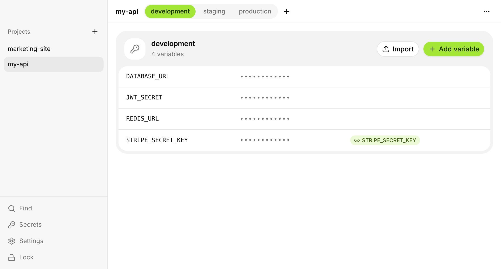

<p align="center">
  
</p>

<h1 align="center">dotsafe</h1>

<p align="center">
  Local-first, zero-knowledge secret manager for developers.<br>
  Your <code>.env</code> files and API keys, encrypted on your Mac and synced through storage you already own.
</p>

<p align="center">
  <a href="https://dotsafe.dev">Website</a> ·
  <a href="https://dotsafe.dev/docs">Docs</a> ·
  <a href="https://dotsafe.dev/changelog">Changelog</a> ·
  <a href="https://github.com/starc007/dotsafe/releases/latest/download/dotsafe.dmg">Download</a>
</p>

<p align="center">
  
</p>

## Why dotsafe

- **No server holds your vault.** Secrets are encrypted on your device and synced through iCloud Drive, Google Drive, Dropbox, an S3 or R2 bucket, or WebDAV. The only dotsafe server handles licenses and never sees a secret.
- **One vault, two tools.** A desktop app and a `dotsafe` CLI share the same vault and the same Rust core.
- **Agents run with your keys, never see them.** Claude Code, Cursor and other MCP agents can run commands with your secrets after you approve with Touch ID. Output comes back redacted.
- **Rotation built in.** Link one secret across projects, rotate it everywhere at once, and push the new key to Vercel, Cloudflare Workers, Netlify, Fly.io or AWS Parameter Store.
- **Works offline.** Every machine keeps an encrypted copy and syncs when it's back online.

## Install

Download the latest release from [GitHub Releases](https://github.com/starc007/dotsafe/releases/latest):

- **Desktop app:** [dotsafe.dmg](https://github.com/starc007/dotsafe/releases/latest/download/dotsafe.dmg) (universal, signed and notarized). It updates itself.
- **CLI:** comes inside the app. Settings → Agents → Install links it into `/usr/local/bin`, and it updates with the app. Without the app, download `dotsafe-<version>-macos-universal.tar.gz` (signed and notarized), unpack it and put `dotsafe` on your `PATH`.
- **Linux (x86_64 and arm64):** [dotsafe.deb](https://github.com/starc007/dotsafe/releases/latest/download/dotsafe.deb) installs the app and the CLI. Elsewhere, [dotsafe.AppImage](https://github.com/starc007/dotsafe/releases/latest/download/dotsafe.AppImage) plus `dotsafe-<version>-linux-x86_64.tar.gz` for the CLI. On arm64: [dotsafe-arm64.deb](https://github.com/starc007/dotsafe/releases/latest/download/dotsafe-arm64.deb), [dotsafe-aarch64.AppImage](https://github.com/starc007/dotsafe/releases/latest/download/dotsafe-aarch64.AppImage) and `dotsafe-<version>-linux-aarch64.tar.gz`. See [Install](https://dotsafe.dev/docs/install#linux) for what differs.

dotsafe is paid, with no free version: one license is $49 and covers up to 2 computers, Mac or Linux. Activate it in the app's first screen or with `dotsafe license activate <key>`. Either one is enough.

## Quick start

```bash
dotsafe init                 # create a vault (iCloud Drive by default) or connect to one
dotsafe import               # import ./.env into this project's development environment
dotsafe set API_KEY          # prompts for the value, so it stays out of shell history
dotsafe run -- bun dev       # run a command with the variables injected
dotsafe unlock --for 8h      # cache the key in the OS keychain; `dotsafe lock` to forget it
```

The first write in a directory creates a project and a `.dotsafe.json` link file. It only holds ids, so commit it: other machines connected to the same vault pick the project up. `dotsafe link <name>` attaches a directory to an existing project.

## Features

### Environments and variables

Each project has environments (development, staging, production…). An environment can inherit another's variables and override or hide the ones it doesn't want. Values can reference other variables with `${{ NAME }}`.

```bash
dotsafe set 'DB_URL=postgres://${{ DB_HOST }}/app'
dotsafe inherit production -e staging          # staging gets production's variables; its own win
dotsafe unset -e staging --hide SENTRY_DSN     # drop an inherited variable from staging only
dotsafe diff staging production                # what's only in one, which values differ; names only
dotsafe example -o .env.example                # names to commit; `dotsafe check` fails if one isn't set
```

### Secrets and rotation

Make any variable a secret to keep its history and rotate it in one step. Environments in any project can link to the same secret, and rotating updates all of them. A bad rotation can be rolled back, and unlinked copies are flagged so they don't go stale. The app reminds you when secrets are due.

```bash
dotsafe secret share STRIPE_KEY --all          # one shared secret, linked wherever it had the same value
dotsafe secret rotate STRIPE_KEY --leaked --generate
dotsafe secret retire STRIPE_KEY               # once the old value is revoked with its provider
dotsafe secret history STRIPE_KEY              # versions and notes, never values
dotsafe secret due                             # what's due under each secret's rotation policy
```

### Provider rotation and deploy targets

Connect OpenAI, a Cloudflare API token or AWS IAM, and rotating a secret asks the provider for a new key. Anthropic and Stripe keys are made in their own console: paste the new one and dotsafe checks it, makes it live and pushes it.

The new key is saved first, then checked, made live in every linked environment, and pushed to the deploy targets you choose: Vercel projects, Cloudflare Workers, Netlify sites, Fly.io apps or AWS Parameter Store. The old key keeps working until you retire it, or is revoked at once if it leaked. dotsafe calls the services from your machine with your own admin tokens, stored in the vault.

```bash
dotsafe connect openai --set project_id=proj_…
dotsafe connect vercel --name web
dotsafe secret provider OPENAI_API_KEY --connection OpenAI
dotsafe secret target add OPENAI_API_KEY --connection web --set project=my-app
dotsafe secret rotate OPENAI_API_KEY           # new key from OpenAI, live everywhere, pushed to Vercel
dotsafe secret retire OPENAI_API_KEY           # revokes the old key at OpenAI
```

Set it up in Settings → Integrations, or with `dotsafe connect` (`openai`, `cloudflare_token`, `aws_iam`, `anthropic`, `stripe`, `vercel`, `cloudflare_workers`, `netlify`, `fly`, `aws_ssm`).

### AI agents

`dotsafe mcp` lets MCP agents run commands with your secrets without ever seeing them.

- Agents can list names, never values.
- When an agent asks to run a command, the app shows exactly what will run and with which variables. You allow it once or for a while, confirming with Touch ID.
- Output comes back with secret values replaced by `[dotsafe:NAME]`.
- OpenAI and Anthropic keys go through a local proxy, so the command never holds the real key.
- Agents can add random secrets (`JWT_SECRET`…) without seeing the value.
- Every request is written to an encrypted audit log (`dotsafe audit`).

```bash
claude mcp add dotsafe -- dotsafe mcp          # Claude Code
dotsafe mcp setup                              # other agents
dotsafe daemon                                 # serve agents without the app; approve in the terminal
```

On a server, `dotsafe daemon --detach` keeps the vault key in memory only, and cron jobs run with `dotsafe run -- ./job.sh`. Each new job is approved once with `dotsafe approve`, which asks for the master password. Nothing usable is left on disk. See [Servers and cron jobs](https://dotsafe.dev/docs/servers).

The proxy protects your own dev servers too: `dotsafe run --proxy -- bun dev` gives the process a placeholder key and a local URL. Add more providers with `dotsafe proxy add` or in Settings → Agents. Profiles live in the vault, so an agent can't redirect a key.

### Leak checks

```bash
dotsafe scan                    # find vault values in this checkout, raw or encoded; names only
dotsafe scan --install-hook     # pre-commit hook that runs `dotsafe scan --staged`
dotsafe export -o .env          # owner-only file, refused unless it's gitignored
```

### Storage

A vault lives in any synced folder by default. It can also live in an S3-compatible bucket (Cloudflare R2, AWS S3, Backblaze B2, MinIO) or on WebDAV. The bucket only ever holds encrypted files. Storage keys are kept in the OS keychain, or read from `DOTSAFE_S3_ACCESS_KEY_ID` and `DOTSAFE_S3_SECRET_ACCESS_KEY` for CI. Give that key access to this one bucket only.

```bash
dotsafe init --bucket my-vaults --endpoint https://<account>.r2.cloudflarestorage.com
dotsafe init --webdav https://cloud.example.com/remote.php/dav/files/me/dotsafe/ --user me
dotsafe sync                             # buckets: exchange changes now
dotsafe backup --to ~/Backups/dotsafe    # a dated, still-encrypted copy; the last 10 are kept
dotsafe move --bucket … --endpoint …     # move the vault; the old copy stays until you delete it
```

### Import

```bash
dotsafe import --from doppler            # or --from infisical
dotsafe import --from 1password --item NAME
```

### Devices

Turn on Touch ID unlock in Settings → Devices (the password is still asked every two weeks). Add a Mac with a one-time code instead of typing the password there. If a device is lost, remove it: dotsafe switches the vault to a new key and re-encrypts everything, then lists every secret the old device could read until each one is rotated (`dotsafe secret queue --rotate`).

### In the app

- **⌘K** finds a variable in any project and copies it, or jumps to an environment.
- **⌥⌘K** or the menu bar icon does the same from any other app.
- Copied values are cleared from the clipboard after 30 seconds.
- If dotsafe reads a record older than one it saw before, or one sealed with a key the vault no longer has, the sidebar shows "Vault needs a look" and Settings → Security explains it.

## Security model

- Encryption uses XChaCha20-Poly1305, with keys derived from your password by Argon2id. Records are bound to their vault and id, so they can't be swapped, and older copies are flagged. See [docs/vault-format.md](docs/vault-format.md) and the [threat model](docs/architecture/threat-model.md).
- Decrypted values reach the app's webview only when you reveal or edit one. Lists carry names only.
- Copying happens in Rust, never through the webview's clipboard.
- The vault locks after 15 minutes without activity, by default.
- The webview has no clipboard or filesystem permissions, only the folder picker, and a strict CSP blocks remote content.
- Agents never get values. Values only reach processes the broker starts after you approve.

For CI and scripts, `DOTSAFE_PASSWORD` supplies the master password without a prompt. Anything that can read the environment can read it, so prefer `dotsafe unlock` on your own machine.

## License

The code is [MIT](LICENSE): use it, change it and share it however you like.

The name "dotsafe" and the logo aren't covered by the license. A fork or a build of your own is welcome, but give it another name and logo, so nobody mistakes it for the official app.

Want to help? See [CONTRIBUTING.md](CONTRIBUTING.md).
